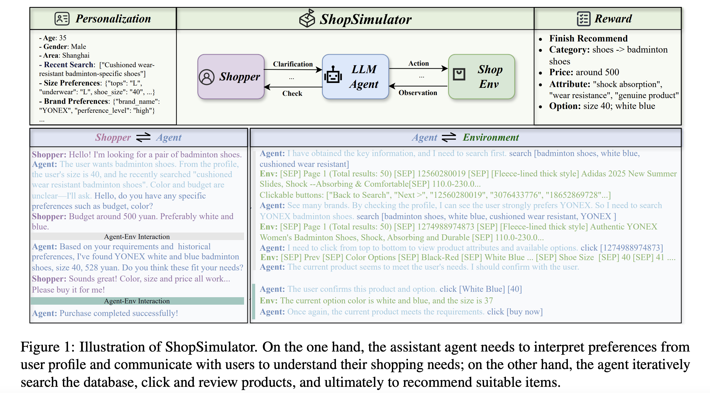
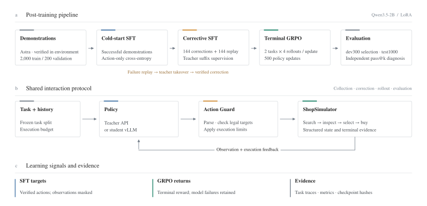
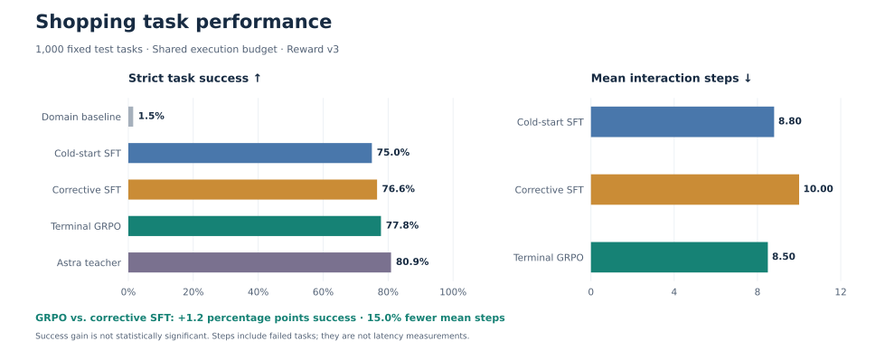
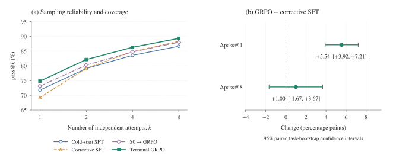
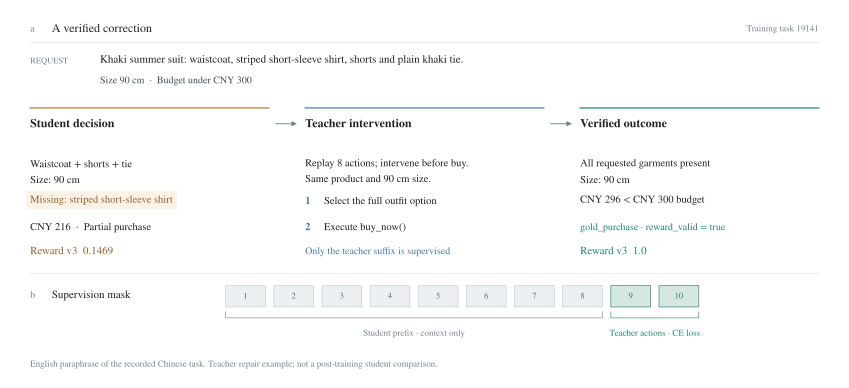

<h1 align="center">E-Commerce Agent:<br>Constraint-Aware Post-Training with SFT &amp; GRPO</h1>

<p align="center"><strong>Post-training for multi-constraint shopping decisions</strong><br>Trajectory distillation · Corrective fine-tuning · Online reinforcement learning</p>

<p align="center">
  <a href="README.md">中文</a> ·
  <a href="docs/results.md">Results</a> ·
  <a href="next/docs/project-completion-plan.md">Design</a> ·
  <a href="docs/reproduce.md">Reproduction</a> ·
  <a href="docs/README.md">Documentation</a>
</p>

A shopping agent must search, inspect products, select options, and purchase while respecting budget, brand, feature, and specification constraints. This project trains **Qwen3.5-2B** in **ShopSimulator**, connecting teacher demonstrations, student failure correction, and online GRPO to study task success and interaction efficiency.

<details>
<summary>Task environment: ShopSimulator</summary>



<sub>ShopSimulator environment illustration; see <a href="THIRD_PARTY_NOTICES.md">sources</a>. This project uses fixed shopping tasks under the shared <a href="docs/architecture.md">execution protocol</a>.</sub>

</details>

## Training pipeline



The post-training pipeline, shared interaction loop, and learning signals. Collection, training rollouts, and evaluation use the same execution protocol.

| Stage | Implementation |
|---|---|
| **Data and demonstrations** | Audit 23,421 source tasks; isolate splits by product and near-duplicate requirements. Collect **2,000 verified successful training trajectories** and 200 validation trajectories from Astra interacting with the environment. |
| **SFT and failure correction** | Supervise assistant actions. Replay student failure prefixes and verify teacher continuations in the environment. Train on **144 corrections + 144 replay demonstrations**, masking the student prefix in correction examples. |
| **Online GRPO** | Two H100 80GB GPUs, LoRA, veRL policy loss, and vLLM sampling. A 2,000-task pool, **2 tasks × 4 trajectories** per update, 500 updates. Retain model-failure penalties; filter infrastructure failures and unverifiable outcomes; resample informative groups. |
| **Evaluation** | Shared action guards, observations, and execution budgets. Select on dev300, compare on test1000, and diagnose stochastic reliability. Retain per-task trajectories, checkpoint identities, and training logs. |

## Main results

### Fixed test set · 1,000 tasks

Strict success requires a complete, verifiable `gold_purchase` with `reward_valid=true` and `purchase_success=true`. All models share the same tasks and execution budget.



Figure 1. Strict success and mean interaction length on test1000. The teacher is a reference. Steps include all tasks, including early failures, and do not measure successful-task latency.

| Model | Strict success | Mean Reward v3 | Mean steps |
|---|---:|---:|---:|
| Qwen3.5-2B, before domain training | 1.5% | −0.1039 | 5.748 |
| Cold-start SFT (S0) | 75.0% | 0.7034 | 8.800 |
| Corrective SFT | 76.6% | 0.7229 | 10.000 |
| **Terminal GRPO (step500)** | **77.8%** | **0.7364** | **8.498** |
| Astra teacher reference | 80.9% | 0.7837 | 10.390 |

Correction and GRPO together improve on cold-start SFT by **2.8 percentage points**. GRPO adds **1.2 points** over corrective SFT and reduces mean steps across all tasks by **15.0%**.

### Sampling diagnostics · dev300

Eight independent executions per task, with `temperature=1, top_p=1`. pass@1 estimates single-sample success; pass@8 measures success coverage within eight attempts.



Figure 2. Eight independent samples per task on dev300 (temperature=1, top_p=1). Left: pass@k for four fixed models. Right: terminal GRPO gains over corrective SFT, with 95% paired task-bootstrap intervals.

| Model | pass@1 | pass@8 |
|---|---:|---:|
| Cold-start SFT | 71.79% | 86.67% |
| Corrective SFT | 69.29% | 88.33% |
| S0 → GRPO (step450) | 73.12% | 88.00% |
| **Corrective SFT → terminal GRPO** | **74.83%** | **89.33%** |

GRPO improves pass@1 over corrective SFT by **5.54 points**, with a paired task-bootstrap 95% interval of **[3.92, 7.21]**. The diagnostic supports improved single-sample reliability; the pass@8 gain is not statistically significant.

**Scope.** These are single-training-seed results. The +1.2-point test gain is not significant in the paired test (`p=0.2242`), and wrong purchases increase from 12 to 26. Mean steps include failed tasks; pass@8 is oracle-verified coverage, not deployment success. The fixed test set has been inspected across multiple experiments. See the [full results](docs/results.md) for paired outcomes and limitations.

## A verified correction

A student selected the right product and size but omitted the requested striped shirt from the outfit. The teacher replayed the eight-action prefix, changed the outfit option, and completed a verified purchase within budget. Only the two teacher actions become correction targets.



This is a real training-data example, not a before/after student evaluation. The [case study](next/docs/data-reflow/case-study.md) includes the original Chinese request, exact option values, terminal evidence, and supervision boundary.

## Documentation and reproduction

| Topic | Guide |
|---|---|
| Method and system design | [Plan](next/docs/project-completion-plan.md) · [Architecture](docs/architecture.md) |
| Data, teachers, SFT, correction, and GRPO | [Stage documentation](docs/README.md) |
| Setup, training, evaluation, and reward extensions | [Execution guide](docs/reproduce.md) |
| Ablations and negative results | [Experiments](docs/experiments.md) |
| Models, logs, trajectories, and resource use | [Artifacts](docs/artifacts.md) · [Resource accounting](next/docs/resource-usage.md) |

The current implementation lives in `next/`:

```text
next/
├── src/shopping_agent/   Shared interaction and evaluation protocol
├── scripts/             Collection, training, evaluation, and archiving
├── configs/             Execution protocol and experiment recipes
├── data/                Task splits, demonstrations, and corrections
├── results/             Metrics, model manifests, and archive indexes
└── docs/                Methods and results by stage
```

Training uses two H100 80GB GPUs with fixed software versions and model revisions. Existing teacher data can be reused; fresh collection requires teacher API access. Weights and large logs are externally archived and require storage access. See the [execution guide](docs/reproduce.md) for setup and recovery.

Figure sources, vector downloads, and reproduction commands are listed in the [figure index](docs/assets/README.md). [Test data](next/results/evaluation/test-comparison/summary.json) · [pass@k data](next/results/passk/dev300/summary.json) · [Dependencies and provenance](THIRD_PARTY_NOTICES.md)
