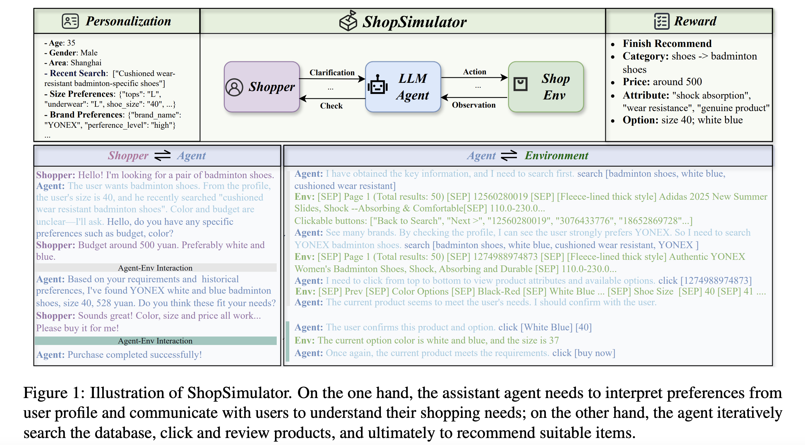
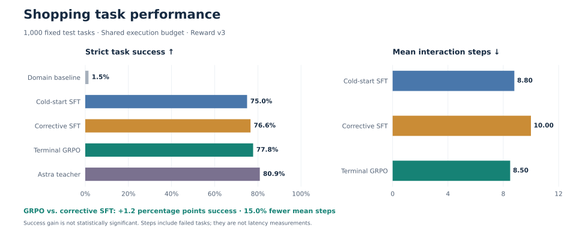
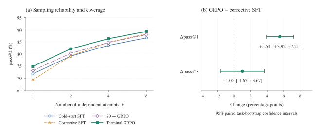

<h1 align="center">E-Commerce Agent:<br>Constraint-Aware Post-Training with SFT &amp; GRPO</h1>

<p align="center"><strong>面向多约束电商决策的 Agent 后训练</strong><br>轨迹蒸馏 · 失败回流 · 在线强化学习</p>

<p align="center">
  <a href="README.en.md">English</a> ·
  <a href="docs/results.md">实验结果</a> ·
  <a href="next/docs/project-completion-plan.md">方法与设计</a> ·
  <a href="docs/reproduce.md">运行指南</a> ·
  <a href="docs/README.md">文档</a>
</p>

在预算、品牌、功能和规格等约束下，购物 Agent 需要连续完成搜索、商品核验、规格选择和购买。本项目基于 **Qwen3.5-2B** 与 **ShopSimulator**，构建从教师示范、学生纠错到在线 GRPO 的训练流程，研究小模型的任务完成率与交互效率。



<sub>ShopSimulator 环境示意，来源见<a href="THIRD_PARTY_NOTICES.md">依赖与来源</a>。本项目使用固定购物任务，执行协议见<a href="docs/architecture.md">系统架构</a>。</sub>

## 训练流程


| 环节 | 实现 |
|---|---|
| **数据与示范** | 筛选 23,421 个原始任务，按商品及近重复需求分组隔离；采集 Astra 在真实环境交互中完成的 **2,000 条成功训练轨迹**与 200 条验证轨迹。 |
| **SFT 与失败回流** | 监督 assistant 动作；回放学生失败前缀，由教师接管并通过环境验收。**144 条纠错轨迹 + 144 条示范回放**用于增量训练，纠错样本只监督教师后缀。 |
| **在线 GRPO** | 两张 H100 80GB，LoRA、veRL 策略损失与 vLLM 采样；2,000 题训练池，每次更新 **2 题 × 4 条轨迹**，共 500 次更新。保留模型失败负反馈，过滤环境异常与不可验证样本，动态补采有效组。 |
| **评测** | 共享交互协议、动作守卫和执行预算；dev300 选模，test1000 比较，多次采样诊断可靠性。保留逐题轨迹、检查点身份和训练日志。 |

## 主要结果

### 固定测试集 · 1,000 题

严格成功要求完成可验证的 `gold_purchase`，同时满足 `reward_valid=true` 与 `purchase_success=true`。所有模型使用相同任务与执行预算。



| 模型 | 严格成功率 | 平均 Reward v3 | 平均交互步数 |
|---|---:|---:|---:|
| Qwen3.5-2B，领域训练前 | 1.5% | −0.1039 | 5.748 |
| 冷启动 SFT（S0） | 75.0% | 0.7034 | 8.800 |
| 纠错 SFT | 76.6% | 0.7229 | 10.000 |
| **终局 GRPO（step500）** | **77.8%** | **0.7364** | **8.498** |
| Astra 教师参考 | 80.9% | 0.7837 | 10.390 |

相对冷启动 SFT，纠错与 GRPO 累计提升 **2.8 个百分点**。其中 GRPO 相对纠错 SFT 提升 **1.2 个百分点**，全任务平均交互步数减少 **15.0%**。

### 多次采样诊断 · dev300

每题独立执行 8 次，`temperature=1, top_p=1`。pass@1 衡量单次随机执行成功率，pass@8 衡量八次尝试中至少成功一次的覆盖率。



| 模型 | pass@1 | pass@8 |
|---|---:|---:|
| 冷启动 SFT | 71.79% | 86.67% |
| 纠错 SFT | 69.29% | 88.33% |
| S0 → GRPO（step450） | 73.12% | 88.00% |
| **纠错 SFT → 终局 GRPO** | **74.83%** | **89.33%** |

GRPO 相对纠错 SFT 的 pass@1 提升 **5.54 个百分点**，任务配对 bootstrap 95% 区间为 **[3.92, 7.21]**。结果主要体现单次采样可靠性的改善，pass@8 的增益尚不显著。

**结果范围。** 当前为单训练种子；test1000 的 +1.2 个百分点未达配对显著性（`p=0.2242`），错误购买从 12 增至 26。步数统计包含失败任务，pass@8 也不代表部署成功率。测试集已用于多轮实验报告，详细得失与统计说明见[完整结果](docs/results.md)。

## 文档与复现

| 内容 | 入口 |
|---|---|
| 整体方法与模块设计 | [执行计划](next/docs/project-completion-plan.md) · [系统架构](docs/architecture.md) |
| 数据、教师、SFT、纠错与 GRPO | [各阶段方法与结果](docs/README.md) |
| 环境准备、训练、评测与 Reward 扩展 | [运行指南](docs/reproduce.md) |
| 对照实验与未增益方案 | [实验档案](docs/experiments.md) |
| 模型、训练日志、逐题轨迹与资源用量 | [工件索引](docs/artifacts.md) · [资源统计](next/docs/resource-usage.md) |

当前实现位于 `next/`：

```text
next/
├── src/shopping_agent/   共享交互与评测协议
├── scripts/             数据采集、训练、评测与归档
├── configs/             执行协议与实验配方
├── data/                任务划分、教师示范与纠错数据
├── results/             指标、模型清单与归档索引
└── docs/                各阶段方法与结果
```

训练环境为两张 H100 80GB，软件版本与模型 revision 固定。已有教师数据可直接复用；重新采集需要教师 API。模型权重与大体积日志存于外部归档，恢复需要相应存储权限，具体步骤见[运行指南](docs/reproduce.md)。

图表由[绘图脚本](docs/assets/render_results.py)从归档结果生成。[测试数据](next/results/evaluation/test-comparison/summary.json) · [pass@k 数据](next/results/passk/dev300/summary.json) · [依赖与来源](THIRD_PARTY_NOTICES.md)
