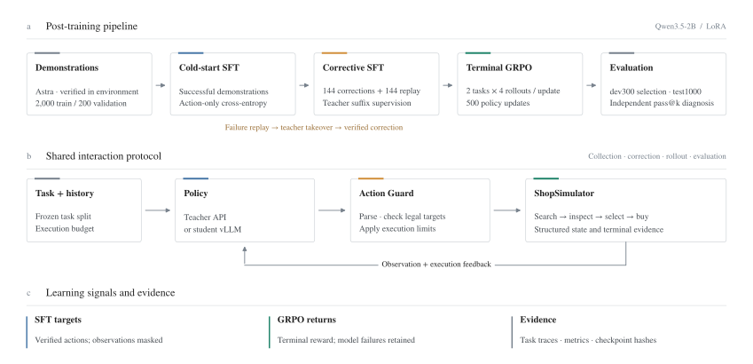

# 系统架构与设计取舍

## 一条共享的交互链路

上层为训练主线，中层为各阶段共享的执行循环，下层区分监督目标、强化学习回报与可追溯证据。

教师采集、学生评测和 GRPO rollout 共用 `next/src/shopping_agent/runtime.py`。每轮一个动作，只允许当前页目标；非法动作返回统一反馈，连续失败按协议结束。每步输入、输出、工具结果和终止原因保留，避免训练与评测使用不同执行规则。

| 层 | 实现 | 职责 |
|---|---|---|
| 数据与隔离 | `next/scripts/prepare_task_pool.py`、`next/data/task_pool/` | 可评分检查、近重复分组、固定划分与哈希 |
| 环境 | `environments/ShopSimulator/shop_env/` | 搜索、商品、规格、购买、Reward v3 |
| Agent | `next/src/shopping_agent/` | 模板、动作、反馈、预算、失败分类、采集和评测 |
| 监督训练 | `next/scripts/sft/`、`next/scripts/reflow/` | 动作 mask、后缀纠错、双卡 token 归一化、选模 |
| 强化学习 | `next/scripts/grpo/` | 在线组采样、奖励/资格、优势、策略更新、检查点 |
| 验证与运维 | `next/scripts/evaluation/`、`passk/`、`sft/artifacts.py` | 固定比较、逐题统计、异步归档与恢复 |

## 三种训练信号

**冷启动 SFT：** 对验收成功示范做 assistant-only 交叉熵，环境观察不作为预测目标。Reward 用于轨迹质量验收，不是 SFT 的梯度目标。

**纠错 SFT：** 学生失败历史作为条件，真实回放后由教师接管；只监督教师纠正后缀，并混合原示范，减轻定向修复对已有能力的破坏。修复轨迹和当前 S0 的来源身份分别保存，不将复用数据描述成当前模型新采的失败。

**主线终局 GRPO：** 可验证终局使用 Reward v3；模型行为导致的未完成终局给 −0.65，基础设施异常和不可验证奖励过滤整组。`A = training_reward − group_mean`，不做标准差归一化；过滤与优势共用 training_reward。只对真实生成的动作 token 更新，同轨迹共享终局优势；这是终局信用，不是步骤级奖励。

训练采用 veRL 的 clipped policy loss，由项目执行器连接精确逐轮历史、双卡 actor 与 vLLM。不是直接启动通用 RayPPOTrainer。两卡按动作历史长度分工，按全局动作 token 归一化；FLA、SDPA、梯度检查点与监督位置投影降低开销。

## 契约与证据

- `next/configs/execution.json` 定义环境、学生 revision、模板、工具与预算；`execution_manifest.json` 锁定依赖和共享源码。
- 训练配方独立于评测口径。Reward 探索不回写 Reward v3 测试成绩；方法变化以新配方、输出目录和运行身份记录。
- 模型保存包含 adapter、优化器、随机状态和采样位置；开发机校验接收后，异步同步外部存储。
- 指标日志用于训练诊断，dev300 用于选模，test1000 用于固定候选比较，pass@k 用于采样可靠性诊断。
- 当前代码保留 `next/` 和内部包名，避免重命名破坏冻结哈希、数据来源路径和恢复入口。项目展示名称与运行身份分离。
