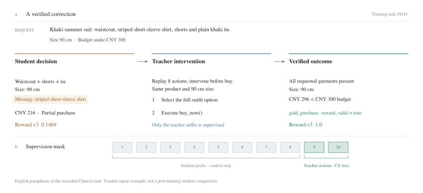

# 纠错案例：补齐遗漏的套餐规格

任务 **19141** 来自训练候选池，是 144 条接收纠错轨迹之一。它展示如何构造可训练的纠正信号，不用于证明训练后的学生已修复同一错误。

## 需求与失败

原始需求：

> 请推荐一款适合幼儿园小朋友演出时穿的卡其色西装套装，要包含马甲，条纹短袖衬衫，短裤和卡其纯色领带，要有低调奢华质感，适合身高90厘米的小孩在夏天穿，价格在300元以下。

学生选中了商品 `937352910780` 和 `90cm` 尺码，但套餐为“卡其色（马甲+短裤）+卡其纯色领带”，缺少条纹短袖衬衫。商品和预算正确，并不等于满足完整需求。

## 接管与验证

在失败购买前接管：重置环境，重放前 8 个动作，确认可见历史一致。教师保留商品和尺码，执行两个动作：

1. `select_option`：将“颜色分类”改为“卡其色（马甲+条纹短袖衬衫+短裤）+卡其纯色领带”。
2. `buy_now`：环境根据已选规格确定价格，并返回购买结果。

| 验证项 | 学生原始终局 | 教师接管终局 |
|---|---|---|
| 尺码 | 90cm | 90cm |
| 套餐内容 | 马甲、短裤、领带 | 马甲、条纹短袖衬衫、短裤、领带 |
| 实际价格 / 预算 | 216 / 300 元 | 296 / 300 元 |
| 关键规格得分 | 0.5 | 1.0 |
| Reward v3 | 0.146875 | 1.0 |
| 终止类型 | `partial_alternative_purchase` | `gold_purchase` |
| `reward_valid` | `true` | `true` |
| `purchase_success` | `false` | `true` |

原失败不是服务错误，也不是奖励不可验证；它是规格未满足的有效终局。接管点为可验证的“失败购买前”，不宣称这是最早的语义错误位置。

## 训练信号与来源

`supervise_from_message=18`：前缀 8 个学生动作及全部环境观察仅作为上下文，只有教师后缀的 2 个 assistant 动作计算交叉熵。纠错训练同时混入原始成功示范，避免仅拟合失败状态。

- [案例证据](../../results/data-reflow/r1/case-19141.json)：原始需求、接管位置、教师消息、两份终局与原始记录 SHA-256。
- [接收数据](../../data/reflow/r1/repair.jsonl.gz)：轨迹 ID `4c5b0814-28ca-4e7b-843b-d0e2956b3759`；学生源轨迹 ID `ce4c33f2-ea80-4764-ac0e-74612ca506aa`。
- [采集汇总](../../results/data-reflow/r1/collection.json)与[数据清单](../../data/reflow/r1/manifest.json)：保留采集源模型身份；本轮训练复用该冻结数据，不将其描述为当前选中 S0 新采的失败。

图中英文为上述中文需求与选项的简写；完整动作、价格及评分以案例证据为准。
