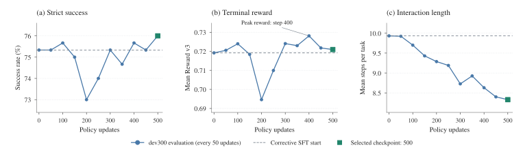

# 终局奖励 GRPO 结果

**当前可用GRPO主结果。** 训练、开发集选模及test1000对照已完成；选中step500，测试778/1000（77.8%），Reward v3为0.7364。完整测试对照见[评测结果](../evaluation/results.md)。下表保留开发集选模过程。

每 50 次更新进行一次完整 dev300 评测，图中直接连接原始观测值，未平滑。虚线为纠错 SFT 起点，绿色方块为选中的 step500；这些是检查点评测指标，不是训练批次的 reward。

| 检查点 | dev300 严格成功 | Reward v3 | 平均动作数 |
|---|---:|---:|---:|
| SFT 起点 | 226/300 | 0.7192 | 9.933 |
| 50 | 226/300 | 0.7205 | 9.923 |
| 100 | 227/300 | 0.7239 | 9.700 |
| 150 | 225/300 | 0.7184 | 9.430 |
| 200 | 219/300 | 0.6946 | 9.287 |
| 250 | 222/300 | 0.7099 | 9.190 |
| 300 | 226/300 | 0.7240 | 8.727 |
| 350 | 224/300 | 0.7229 | 8.927 |
| 400 | 227/300 | 0.7281 | 8.630 |
| 450 | 226/300 | 0.7217 | 8.400 |
| 500 | 228/300 | 0.7209 | 8.330 |

选中 step 500；step 0 表示保留原 SFT。开发集用于选模，不能据此宣称测试收益。

[完整结果与模型身份](../../results/grpo/outcome/summary.json)。

## 结果解读

- step500 相对 SFT 严格成功率增加 0.67 个百分点（226→228），平均动作数减少 16.1%（9.93→8.33）。这是开发集上的小幅收益，不能视为稳定的泛化提升。
- 重复循环从 16 题降至 6 题，但错误购买从 1 题增至 10 题；交互更短不等于购买决策更准确。
- step400 的平均奖励最高，但 step500 严格成功数最多，按预先确定的成功率优先规则选中 step500，没有根据结果更换选模指标。

与 SFT 同题配对：新增成功 10 题、退步 8 题，净变化 +2 题。单种子开发集结果，不能据此声称显著泛化收益。

[配对与计算统计](../../results/grpo/outcome/analysis.json)；[归档清单](../../results/grpo/outcome/archive.json)。
